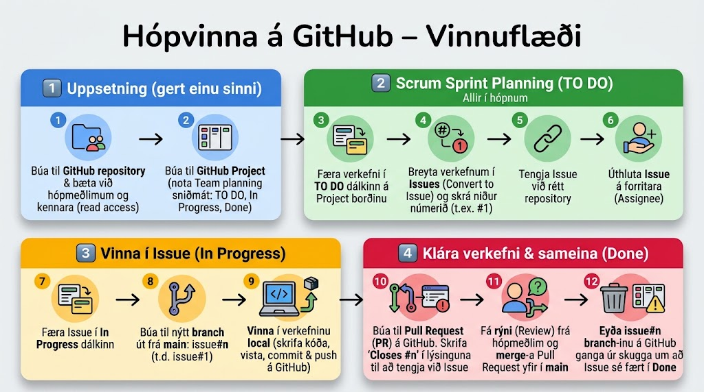

# GitHub hópvinnuflæði

## 1️⃣ Uppsetning (gert einu sinni)

**Skref 1: Búa til GitHub repository og bæta við samstarfsaðilum**

1. Skráðu þig inn á GitHub og búðu til nýtt repository.
2. Bættu hópmeðlimum og kennara (read access) við repository-ið.

**Skref 2: Búa til GitHub Project**

1. Smelltu á **Projects** flipann í repository-inu.
2. Búðu til nýtt Project og notaðu **Team planning** sniðmátið með dálkunum: `TO DO`, `In Progress`, `Done`.

---

## 2️⃣ Scrum Sprint Planning (TO DO) – Allir í hópnum

**Skref 3: Færa verkefni í TO DO dálkinn**

* Í upphafi spretts draga hópmeðlimir þau verkefni sem á að vinna í yfir í **TO DO** dálkinn.

**Skref 4: Breyta verkefnum í Issues**

1. Smelltu á punktana þrjá hjá verkefni á Project borðinu.
2. Veldu **Convert to Issue**.
3. Skráðu niður númerið á Issue-inu (t.d. `#1`).

**Skref 5: Tengja Issue við rétt repository**

* Opnaðu Issue-ið og veldu hvaða repository það tilheyrir.

**Skref 6: Úthluta Issue á forritara (Assignee)**

* Opnaðu Issue-ið og úthlutaðu því á þann hópmeðlim sem ætlar að vinna það.

---

## 3️⃣ Vinna í Issue (In Progress)

**Skref 7: Færa Issue í In Progress dálkinn**

* Þegar vinna hefst, færðu Issue-kortið yfir í **In Progress** dálkinn á Project borðinu.

**Skref 8: Búa til nýtt branch út frá `main**`

* Búðu til nýtt branch sem heitir `issue#n` (þar sem `n` er númerið á Issue-inu).
Dæmi: `git checkout -b issue#1`

**Skref 9: Vinna í verkefninu local**

* Skrifaðu kóðann og gerðu nauðsynlegar breytingar.
* Vistaðu (add), gerðu commit og ýttu (push) branch-inu á GitHub.

---

## 4️⃣ Klára verkefni & sameina (Done)

**Skref 10: Búa til Pull Request (PR)**

1. Farðu inn á repository-ið á GitHub.
2. Smelltu á **Compare & pull request** hjá nýja branch-inu þínu.
3. Skrifaðu `Closes #n` (t.d. `Closes #1`) í lýsinguna (description) til að tengja PR við Issue-ið. Þetta tryggir að Issue-ið lokist sjálfkrafa þegar PR er samþykkt.

**Skref 11: Fá rýni (Review) og merge-a**

1. Bættu hópmeðlim við sem Reviewer og biddu um yfirferð á kóðanum.
2. Þegar PR hefur verið samþykkt, smelltu á **Merge pull request** til að sameina kóðann við `main` branch-ið.

**Skref 12: Eyða branch og uppfæra Project borðið**

1. Eyddu `issue#n` branch-inu á GitHub eftir sameiningu til að halda repository-inu hreinu.
2. Farðu á Project borðið og gakktu úr skugga um að Issue-ið sé núna í **Done** dálkinum (gerist oftast sjálfkrafa ef PR var tengt rétt).
